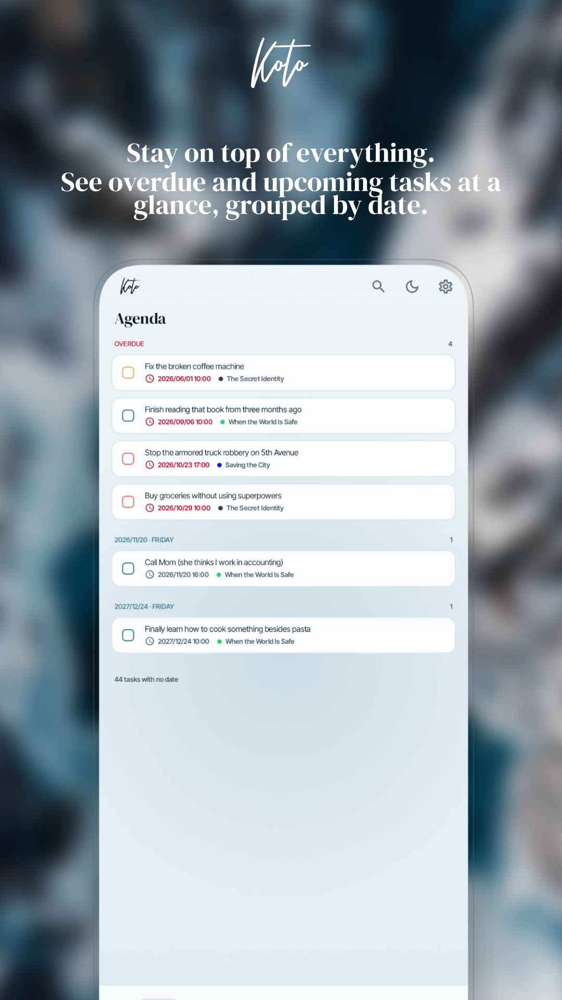
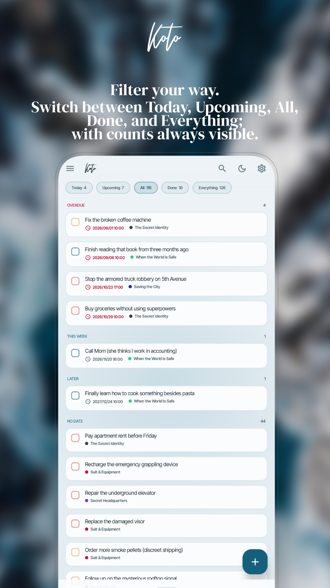
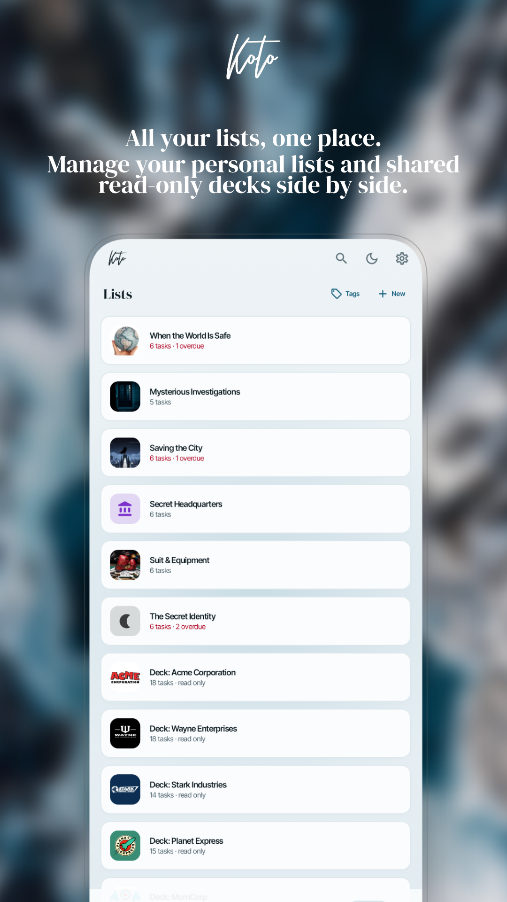
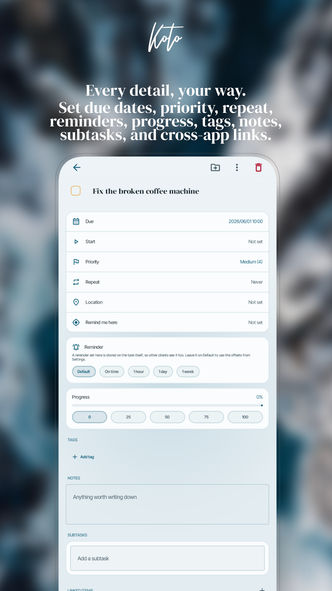
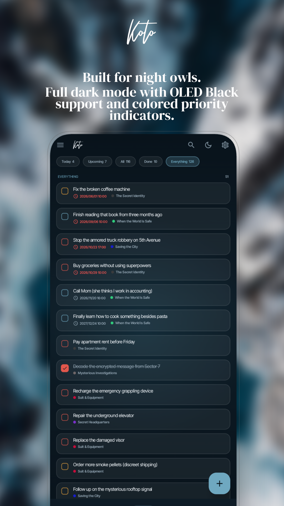
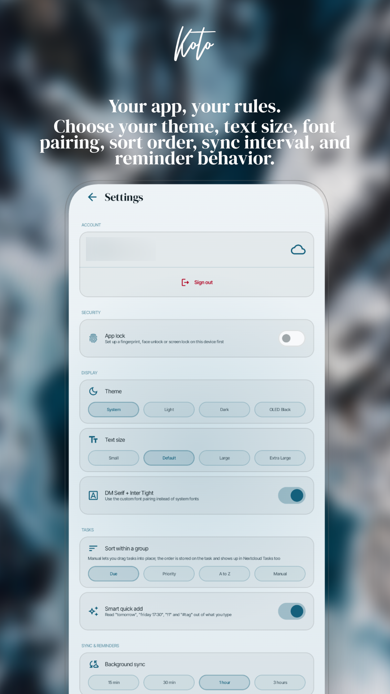

# Koto — Tasks for Nextcloud

> Your tasks, your server. CalDAV, directly — no DAVx5/ICSx bridge required.


[](https://play.google.com/store/apps/details?id=com.brbrs.zaman)
[](https://android.barburas.com/repo)
[](LICENSE)


---

Koto is a free, open-source, privacy-first task manager for Android. Your to-dos, lists, and reminders live entirely on your own Nextcloud — no third-party servers, no tracking, no ads.

---

## Screenshots

| Agenda | Tasks | Lists |
|--------|-------|-------|
|  |  |  |

| Task Detail | Dark Mode | Settings |
|-------------|-----------|----------|
|  |  |  |

---

## Features

- **Direct CalDAV** — PROPFIND collection discovery, `sync-collection` REPORT with sync tokens, full fetch fallback, read/write, over OkHttp. No Android `CalendarContract`, no DAVx5/ICSx bridge
- **Agenda, Tasks & Lists** — Agenda shows a dated timeline across every list. Tasks groups into Overdue, Today, Tomorrow, This Week, Later and No Date, with Today, Upcoming, All, Done and Everything filters. Lists shows all your task lists with cover images, icons and task counts
- **Rich task details** — due and start dates, priority (1-9, color-coded), repeat rules (daily, weekly, monthly, yearly, with ordinal BYDAY/BYSETPOS), progress, location, notes, tags and subtasks — all synced as standard VTODO so other CalDAV clients see the same data
- **Local reminders** — per-task VALARM or global offsets from Settings. All-day tasks fire at 09:00. A Complete action on the notification ticks the task off without opening the app. Alarms survive reboot
- **Smart quick add** — recognizes "tomorrow", "friday 17:30", "!2" and "#tag" out of what you type
- **Tag management** — rename or recolor a tag and Koto rewrites every task that carries it; tags can be filtered across all lists
- **Location reminders** — set a radius on a task and get notified on arrival, built on AOSP LocationManager (no Google Play Services)
- **Attachments** — attach files from the detail screen or share directly from other apps; files go to `/Koto/attachments/` on your own Nextcloud and link as standard ATTACH properties
- **Linked items** — link a task to a Vinci contact, a Nóta note, a Tavla card or any pasted URL; "Send to Nóta" and "Send to Tavla" cross-post a task's title and description as a new note or card
- **Manual ordering** — long-press and drag; order is stored as `X-APPLE-SORT-ORDER` on the task itself, so it syncs and shows up in Nextcloud Tasks too
- **Offline-first** — a local Room cache keeps every task available without a connection; edits queue and push on next sync; a conflicting server edit is merged, not overwritten
- **Portable by design** — settings, list covers, icons, tag colors, and cross-app links are stored in `/Koto/koto-settings.json` on your Nextcloud and restore automatically on a new device after sign-in
- **Biometric lock** — optional fingerprint or face unlock
- **Light / Dark / OLED themes** — plus adjustable text size and the DM Serif Display + Inter Tight font pairing
- **Local-only mode** — export/import a full backup for devices without Nextcloud (suite-wide v2 milestone)

---

## Requirements

- Android 9 (API 28) or higher
- A self-hosted [Nextcloud](https://nextcloud.com) instance with the Tasks app installed

---

## Privacy

Koto has no backend. All data — tasks, lists, settings, attachments — is stored on **your own Nextcloud**. Koto never connects to any server other than the one you configure. No analytics, no crash reporting, no ads, no tracking of any kind.

Privacy policy: [barburas.com/privacy-policy](https://barburas.com/privacy-policy)

---

## Building from Source

```bash
git clone https://github.com/andreibarburas/koto-android.git
cd koto-android
./gradlew assembleDebug
```

Requires Android Studio Ladybug or newer, JDK 17+.

---

## About Author

Hi, I'm [Andrei Barburas](https://barburas.com). By day, I work at the intersection of information management, intelligence gathering, and human cyber risk; designing systems that make sense of complexity and surface what usually stays unseen, drawing on a background in counter-terrorism research and the behavioral patterns behind radicalization and digital vulnerability. I also lecture in Ethics, Communication Management, and Cross-Cultural Management, and write and teach courses on psychology, culture, and critical thinking.

This corner of GitHub is the other side of that same instinct. I build a small collection of free, open-source tools for people who self-host: a suite of [Android Apps](https://github.com/stars/andreibarburas/lists/android-apps) designed around Nextcloud and selfhosters, along with [Home Assistant Apps](https://github.com/andreibarburas/hassio-apps) and a handful of [Wordpress Plugins](https://github.com/andreibarburas/lists/wordpress-plugins).

I started making these because I wanted something the existing options didn't offer; small, focused tools that fit my own self-hosted setup instead of forcing me to compromise. No ads, no tracking, GPLv3 licensed where applicable, and built to work with the tools people already run at home.

## AI Usage

I'm open about the fact that I use AI throughout development. It genuinely helps me move faster and build things I wouldn't otherwise have time for as one person. But AI doesn't replace the actual work; I still spend the evenings figuring out what something should actually do, testing it against real setups and edge cases, and tracking down the inevitable weird bugs. AI is a tool I use, not a shortcut around the thinking.

## Support

If my work saves you time, a small tip means a lot:

- ⭐ **Donate via Bunq (my bank):** [bunq.me/barburasdonations](https://bunq.me/barburasdonations?description=Donation%20from%20Github)
- 🐈‍⬛ **GitHub Sponsors:** [github.com/sponsors/andreibarburas](https://github.com/sponsors/andreibarburas)
- ☕ **Buy me a coffee:** [buymeacoffee.com/barburas](https://buymeacoffee.com/barburas)
- 🌐 **Website:** [barburas.com](https://barburas.com)
- 🐛 **Issues & feature requests:** [open an issue](../../issues)

## Links

- [Play Store](https://play.google.com/store/apps/dev?id=6842866278906089090) [](https://play.google.com/store/apps/dev?id=6842866278906089090)
- [F-Droid Self-Hosted Repo](https://android.barburas.com/repo) [](https://android.barburas.com/repo)
- [r/BarburasLab](https://reddit.com/r/barburaslab) 
- [Privacy Policy](https://barburas.com/privacy-policy/) [](LICENSE)

## Other work on Github

- [Android Apps](https://github.com/stars/andreibarburas/lists/android-apps)
- [Home Assistant Apps](https://github.com/andreibarburas/hassio-apps)
- [Wordpress Plugins](https://github.com/stars/andreibarburas/lists/wordpress-plugins)

## License

All my work is licensed under the [GNU General Public License v3.0](LICENSE).

You are free to use, study, modify, and redistribute this software, provided that any distributed modifications are also licensed under GPL v3 and the source code remains available.

---

*by [andrei BARBURAS](https://barburas.com)* 